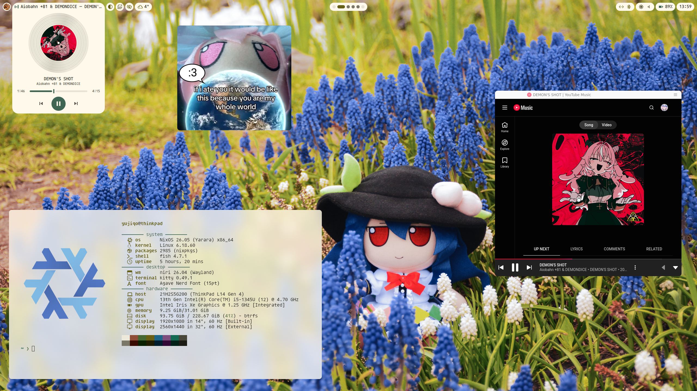
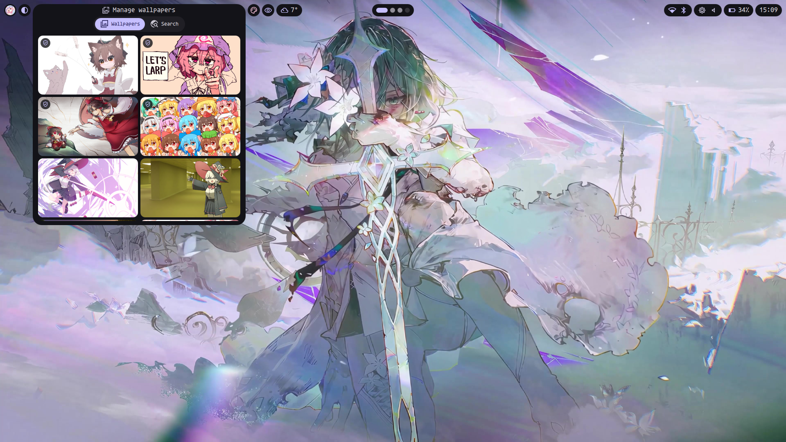
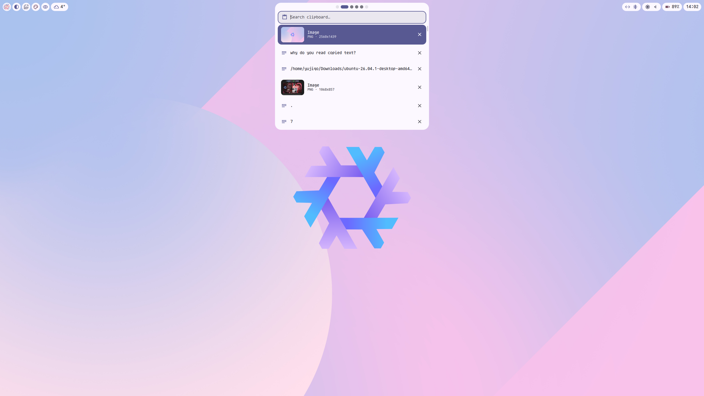
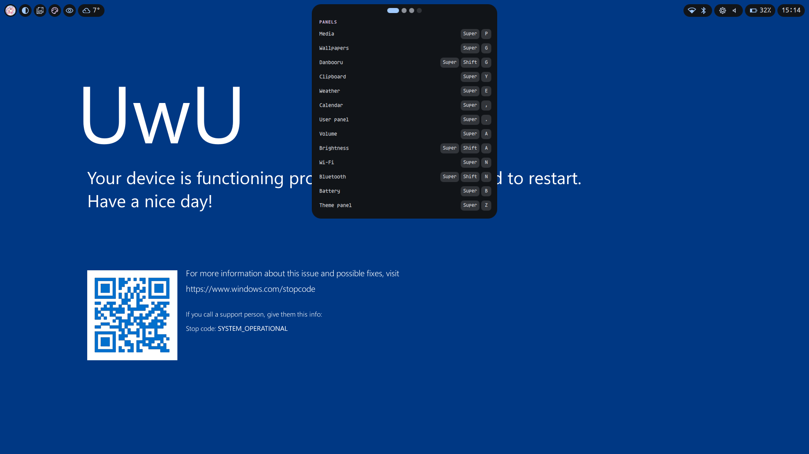
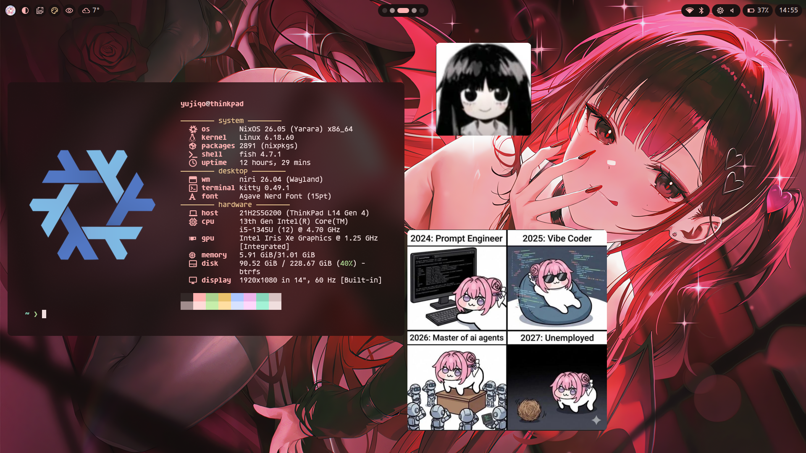

<div align="center">


# yurice

_minimal yet pretty. keyboard first. weeb approved._

[](https://github.com/YaLTeR/niri)
[](https://quickshell.org)
[](https://github.com/InioX/matugen)


[](LICENSE)



</div>

minimal yet pretty configuration, which brings a keyboard oriented workflow and some handy features from different
systems (windows, macos, other linux rices) and shapes it into something i, and maybe other people, enjoy using.

the rice is designed for weebs first, just because there're a lot of weebs that seek freedom in linux, and with
all this open and customizable stuff it's the only option, i guess. **but don't worry!** you can still find something
useful here even if you're not one of us!

---

## Features

### the bar

everything you need to not touch the terminal lives in the bar, which is a row of islands. each island grows
into a panel when you click it (or hit its keybind).

the system part:

- workspaces
- network (wifi) and bluetooth
- volume and brightness
- battery, power profiles and caffeine
- date, time and calendar
- media controls (shows up only when something is playing)

and the external things:

- weather (no account or api key needed)
- wallpapers: your library, wallhaven search, ai upscaling
- danbooru art search
- light/dark theme, manual or on a schedule.
- your user profile: system info and settings

any island can be hidden if you don't need it.

### keybind-only stuff

| keys           | what                                                      |
| -------------- | --------------------------------------------------------- |
| `mod+shift+/`  | keybinds cheatsheet, always in sync with the niri config  |
| `alt+space`    | app launcher. macos-like, so it has a built-in calculator |
| `mod+y`        | clipboard history (text and images)                       |
| `mod+q`        | power menu: power off, reboot, log out, suspend           |
| `print screen` | screenshot tool                                           |

the full list is in [docs/KEYBINDS.md](docs/KEYBINDS.md).

### the switch that makes your system safe for work

the most important feature. the rice has two modes, and the mode decides:

- which avatar to show
- which wallpaper to show
- which bar islands to show

by default they're called "weeb" and "normie", but you decide the naming. some ideas:

- "personal" and "work"
- "regular" and "focus"
- "casual" and "pro"

i think you get the idea. `mod+shift+s` or right click on the eye icon in the bar let's you switch between modes.

### keyboard all the way down

every panel can be used with the keyboard only. open it with its keybind (see the cheatsheet), then:

- `tab` / `shift+tab` to cycle
- `h` `j` `k` `l` or the arrows to move
- `enter` / `space` to press
- `esc` to close

### more screenshots

<table>
  <tr>
    <td width="50%"></td>
    <td width="50%"></td>
  </tr>
  <tr>
    <td width="50%"></td>
    <td width="50%"></td>
  </tr>
</table>

---

## Usage

### install

<details>
<summary><b>nixos</b></summary>

add yurice as a flake input:

```nix
# flake.nix
inputs.yurice.url = "github:yujiqo/yurice";
```

import the modules and turn on what you want:

```nix
# configuration.nix
imports = [inputs.yurice.nixosModules.default];

programs.yurice = {
  enable = true;                     # niri, portals, fonts, pipewire, bluetooth, networkmanager, gvfs, udisks2, ...
  greeter.enable = true;             # quickshell login screen on greetd (optional)
  greeter.niriExtraConfig = ''       # output scaling for the greeter (optional)
    output "eDP-1" { scale 1; }
  '';
};

# home.nix
imports = [inputs.yurice.homeModules.default];

programs.yurice = {
  desktop.enable = true;             # niri + quickshell + matugen
  terminal.enable = true;            # kitty, fish, starship, tmux, neovim, lazygit, fastfetch
};
```

the system services are `mkDefault`, so your host can override them.

if you want to edit the rice live without rebuilding, clone it somewhere and point `configDir` at the checkout:

```nix
programs.yurice.configDir = "${config.home.homeDirectory}/yurice/config";
```

</details>

<details>
<summary><b>arch / debian 13+</b></summary>

the configs are symlinked into the repo, so clone it somewhere it can stay:

```sh
git clone https://github.com/yujiqo/yurice.git ~/yurice
cd ~/yurice
./install.sh                       # asks which parts you want
./install.sh desktop terminal -y   # or pick them upfront
```

| component  | what you get                                                       |
| ---------- | ------------------------------------------------------------------ |
| `desktop`  | niri, quickshell, matugen theming, clipboard history, wallpapers   |
| `terminal` | kitty, fish, starship, tmux, neovim, lazygit, fastfetch, less      |
| `greeter`  | the quickshell login screen on greetd (needs `desktop`, uses sudo) |

useful flags: `--dry-run`, `--no-packages`, `--upscaler=build|aur|release|none`, `-y`. see `./install.sh -h`.

on debian, niri, xwayland-satellite and matugen are built from pinned upstream tags into `/usr/local`.
anything the script would overwrite is backed up first.

</details>

### update

for now updates are manual:

```sh
cd ~/yurice && git pull   # configs are symlinks, so this is most of it
./install.sh              # re-run if new dependencies showed up. it skips what's already done
```

on nixos: `nix flake update yurice`, then rebuild.

### uninstall

```sh
./install.sh --uninstall
```

removes every link, file and unit the script created, and restores the backups. packages stay installed.

### customize

you don't need to fork the repo if you want to change something. every config loads an optional file from `~/.config/yurice/custom/`
last, using the same paths as `config/`:

```text
~/.config/yurice/custom/
├── niri/config.kdl          # anything niri
├── niri/outputs.kdl         # monitors. the display settings in the shell write this one
├── kitty/kitty.conf
├── fish/config.fish
├── tmux/tmux.conf
├── nvim/init.lua
├── quickshell/settings.json # what the user island's settings change
└── avatars/                 # weeb.jpg, normie.jpg
```

`git pull` never touches it. everything about it is in [docs/CUSTOMIZING.md](docs/CUSTOMIZING.md).

### api keys

> [!IMPORTANT]
> keys are plain text files in `~/.config/yurice/`. the shell writes them owner-only (`umask 077`) when you
> enter them in a panel, but if you create them by hand, `chmod 600` them.

| service   | file                             | format                            | needed?                                                  |
| --------- | -------------------------------- | --------------------------------- | -------------------------------------------------------- |
| danbooru  | `~/.config/yurice/danbooru.key`  | line 1: username, line 2: api key | no, it makes sense only if you have premium subscription |
| wallhaven | `~/.config/yurice/wallhaven.key` | line 1: api key                   | no, without it the search is sfw only                    |
| weather   | none                             |                                   | no, it's open-meteo                                      |

danbooru allows you to change permissions for each key. to prevent problems in case your key was leaked you should allow only these:

- `counts:posts`
- `posts:index`
- `users:profile`

---

## Conventions

- configs stay in their own formats (kdl, qml, fish, lua). nix and `install.sh` only install packages and make symlinks.
- every color, size and duration in the shell comes from `Theme.qml`. no hardcoded values.
- if two places need the same thing, it becomes one component in `components/`.
- everything must work with the keyboard only.
- dependencies change in `deps/arch`, `deps/debian` and `nix/packages.nix` together.
- yes i used claude code to build it, but you most likely don't realize how intentional and careful that was.

see more details in [docs/PHILOSOPHY.md](docs/PHILOSOPHY.md).

## Docs

- [docs/book/](docs/book/README.md): how the whole thing is built, from a single qml rectangle up to the full desktop
- [docs/PHILOSOPHY.md](docs/PHILOSOPHY.md): why it's built this way
- [docs/CUSTOMIZING.md](docs/CUSTOMIZING.md): every override hook, setting and file path
- [docs/KEYBINDS.md](docs/KEYBINDS.md): the full list of keybinds
- [docs/TROUBLESHOOTING.md](docs/TROUBLESHOOTING.md): what to do when something breaks
- [docs/CONTRIBUTING.md](docs/CONTRIBUTING.md): read the book and philosophy first, then come here

## Credits

- [niri](https://github.com/YaLTeR/niri) and [quickshell](https://quickshell.org) - the two things this whole rice stands on.
- [matugen](https://github.com/InioX/matugen) - for turning every wallpaper into a theme.
- [end-4's dots](https://github.com/end-4/dots-hyprland) and [iNiR](https://github.com/snowarch/inir) - for ideas and inspiration (iNiR is literally the i used the most on my thinkpad).
- [AngelOS-Dotfiles](https://github.com/MixaDoDs/AngelOS-Dotfiles) - for showing me what claude code is capable of.

---

<div align="center">
<sub>
  <a href="https://github.com/yujiqo/nixos">nixos</a> ·
  <a href="https://github.com/yujiqo/dotfiles">dotfiles</a> ·
  <a href="LICENSE">MIT</a>
</sub>
</div>
